# EZAssetGenerator

[中文](README.md)

EZAssetGenerator provides Unity editor tools for creating meshes, generating textures, and processing textures.

Minimum supported Unity version: 2020.3.

## EZMeshGenerator

Parameterized mesh generation tools (`Assets/Create/EZAssetGenerator/...`).

- [EZPlaneGenerator](#ezplanegenerator): Generates subdivided planes.
- [EZBoxGenerator](#ezboxgenerator): Generates subdivided boxes with rounded corners.
- [EZUVSphereGenerator](#ezuvspheregenerator): Generates subdivided UV spheres.

## EZTextureProcessor

Parameterized texture tools (`Assets/Create/EZAssetGenerator/...`).

- Texture generation (`EZTextureGenerator`)
  - [EZGaussianLutGenerator](#ezgaussianlutgenerator): Generates Gaussian lookup tables.
  - [EZGradient1DTextureGenerator](#ezgradient1dtexturegenerator): Generates textures from a 1D gradient.
  - [EZGradient2DTextureGenerator](#ezgradient2dtexturegenerator): Generates textures from coordinate operations and gradients.
  - [EZWaveTextureGenerator](#ezwavetexturegenerator): Generates wave patterns.
  - [EZPerlinNoiseTextureGenerator](#ezperlinnoisetexturegenerator): Generates Perlin noise textures.
  - [EZPixelNoiseTextureGenerator](#ezpixelnoisetexturegenerator): Generates random pixel noise textures.
  - [EZSimpleNoiseTextureGenerator](#ezsimplenoisetexturegenerator): Generates simple continuous noise textures.
  - [EZVoronoiTextureGenerator](#ezvoronoitexturegenerator): Generates Voronoi diagrams.

- Texture processing (`EZTextureProcessor`; some shaders can also be used for post-processing)
  - [EZTextureBlurProcessor](#eztextureblurprocessor): Blurs textures, including Gaussian blur with a Gaussian lookup table.
  - [EZColorBasedOutline](#ezcolorbasedoutline): Adds outlines based on color tolerance.
  - [EZTextureSpherize](#eztexturespherize): Applies a spherical distortion.
  - [EZTextureTwirl](#eztexturetwirl): Applies a twirl distortion.
  - [EZTextureChannelModifier](#eztexturechannelmodifier): Adjusts texture channels, including swapping, extracting, and applying curves.
  - [EZTextureCombiner](#eztexturecombiner): Combines multiple textures.

- General utilities
  - [EZMaterialToTexture](#ezmaterialtotexture): Renders a material directly to a texture. Do not use shaders that depend on lighting.
  - [EZTexturePipeline](#eztexturepipeline): Runs multiple texture processors in sequence.

## EZMeshGeneratorSamples

### EZPlaneGenerator

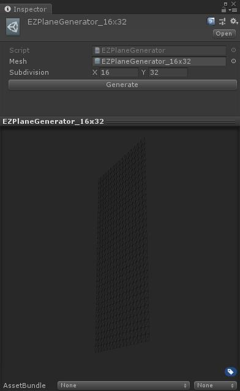

### EZBoxGenerator

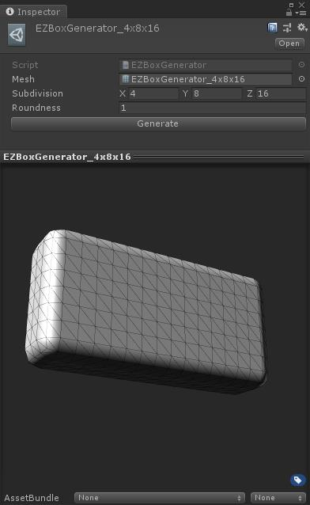

### EZUVSphereGenerator

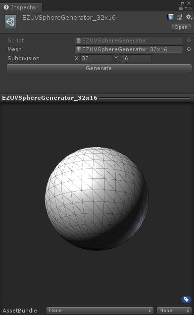

## EZTextureProcessorSamples

### Common output settings

The output format setting does not affect the texture import format.

- Output Resolution: Output texture resolution.
- Output Format: Output texture channel format.
- Output Encoding: Output texture encoding format.
- Output Texture: Output texture to bind. The generated content replaces the texture content without changing its import settings. If this is not specified, a new texture file is created and bound.
- Cooresponding Generator: Other texture generators to run in response. After the current asset finishes, its corresponding generator is executed automatically. If that generator has another corresponding generator, the chain continues in order.

### EZGaussianLutGenerator

Generates Gaussian lookup tables.

- Texture Type
  - Wave: Wave texture.
  - Lut1D: 1D lookup table along the U direction.
  - Lut2D: 2D lookup table.
- Range: Value range.
- Sigma: Standard deviation.

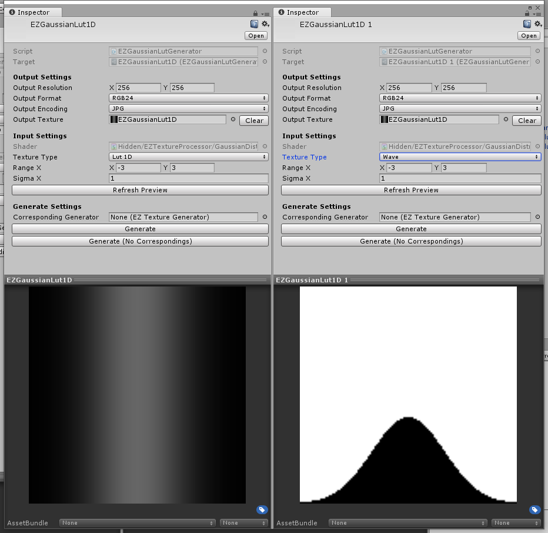

### EZGradient1DTextureGenerator

Maps the U coordinate to a gradient.

- Gradient: Gradient definition.
- Gradient Curve: Gradient curve.

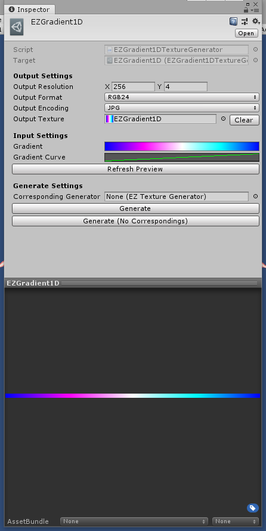

### EZGradient2DTextureGenerator

Maps UV coordinates to a gradient. Combined with UV curves, it can generate complex patterns.

- Gradient: Gradient definition.
- Gradient Curve: Gradient curve.
- Coordinate Mode: Coordinate sampling mode.
  - X: U.
  - Y: V.
  - AdditiveXY: `(U + V) / 2`.
  - MultiplyXY: `U * V`.
  - DifferenceXY: `Abs(U - V)`.
  - Radial: `Sqrt((U - 0.5) ^ 2 + (V - 0.5) ^ 2) * 2`.
  - Angle: `Mathf.Atan2(V - 0.5, U - 0.5) / Mathf.PI * 0.5f`.
- Coordinate Curve U: U-coordinate curve.
- Coordinate Curve V: V-coordinate curve.

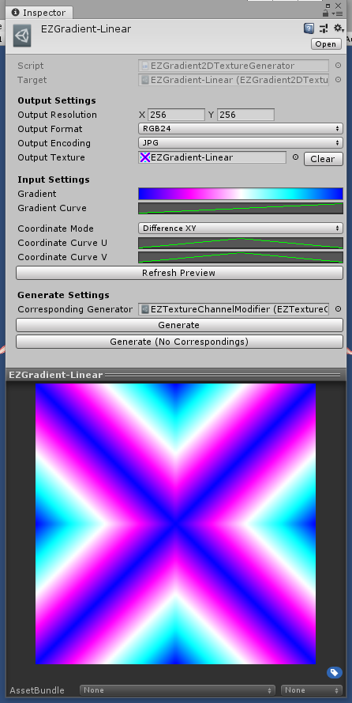

### EZPerlinNoiseTextureGenerator

Generates Perlin noise textures.

- Noise Density: Noise density.

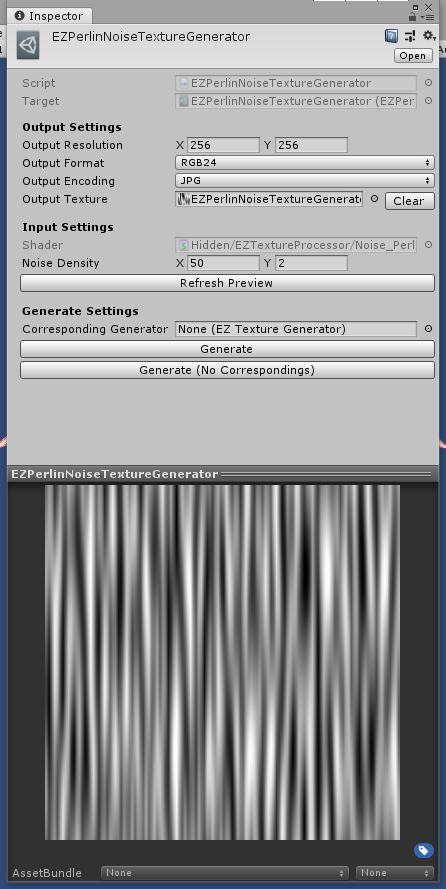

### EZPixelNoiseTextureGenerator

Generates pixel noise textures.

- Random Seed: Random seed.
- Colored: Use colored noise.
- Output Curve: Output curve, which can be used to control noise density.

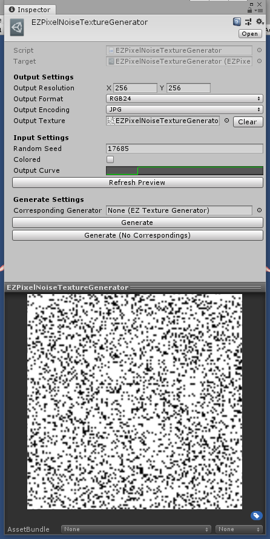

### EZSimpleNoiseTextureGenerator

Generates random noise textures.

- Noise Density: Noise density.

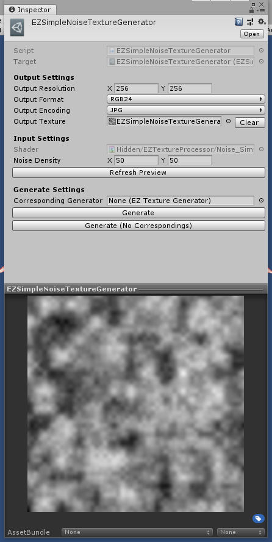

### EZVoronoiTextureGenerator

Generates Voronoi textures.

- Fill Type: Fill mode.
  - Gradient: Gradient from the center to the boundary.
  - Random: Fills cells with random colors.
- Angle Offset: Seed used to generate random vectors.
- Voronoi Density: Noise density.

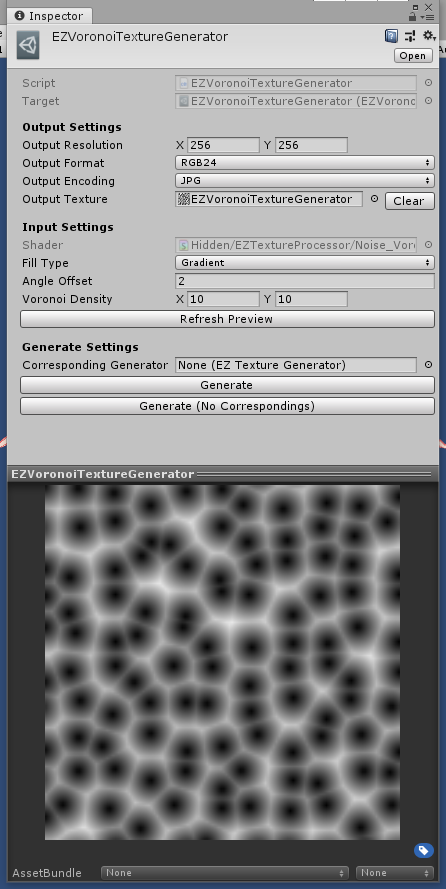

### EZWaveTextureGenerator

Generates wave shapes from a curve.

- Wave Shape: Wave shape curve.
- Antialiasing: Anti-aliasing.

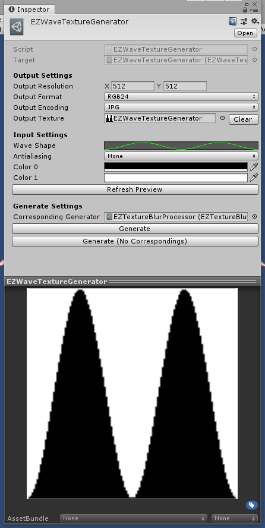

### EZTextureBlurProcessor

Texture blur processor.

- Input Texture: Texture to blur.
- Blur Weight Texture: Weight lookup table used for blurring.
- Blur Radius: Blur radius.

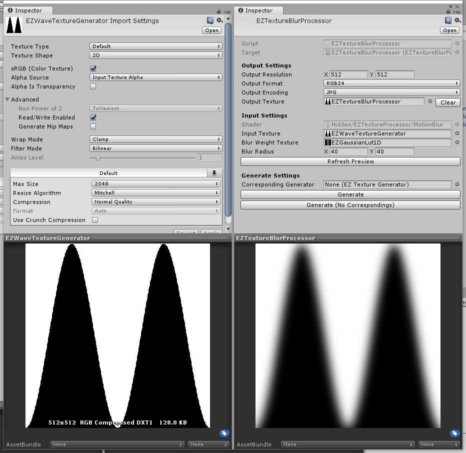

### EZColorBasedOutline

Adds an outline based on color tolerance.

- Input Texture: Texture to outline.
- Gray Weight: Converts the texture to grayscale before outlining; controls the grayscale channel weights.
- Tolerance: Color tolerance.
- Outline Color: Outline color.
- Outline Thickness: Edge inspection range, which controls outline thickness.

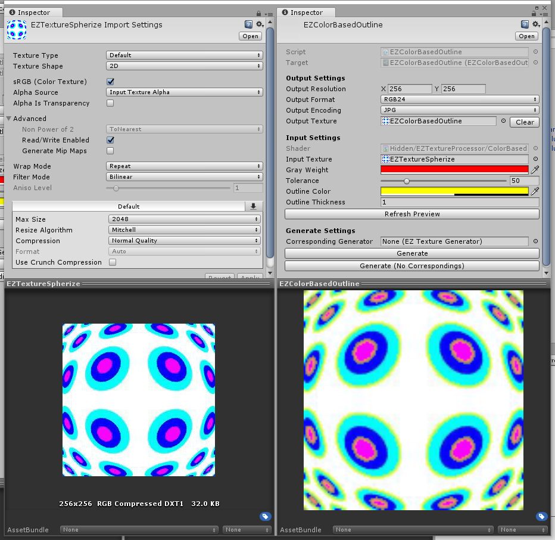

### EZTextureSpherize

Spherical distortion processor.

- Input Texture: Input texture.
- Spherize Power: Spherize intensity.
- Spherize Center: Spherize center.
- Spherize Strength: Spherize range.

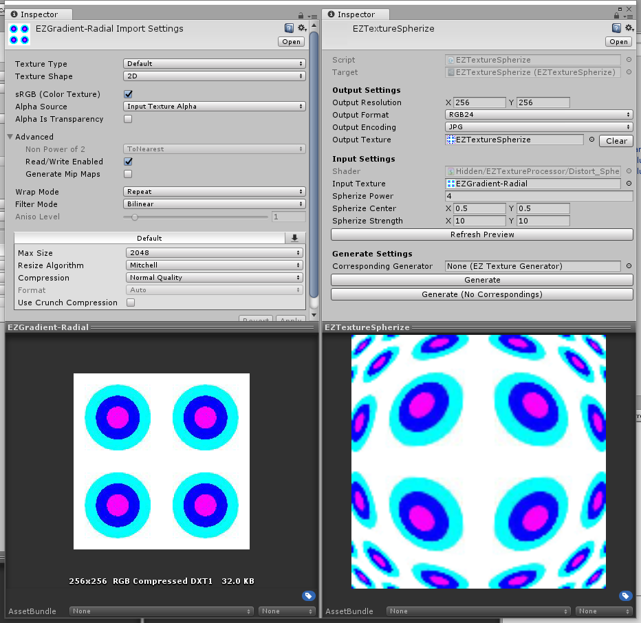

### EZTextureTwirl

Twirl distortion processor.

- Input Texture: Input texture.
- Twirl Center: Twirl center.
- Twirl Strength: Twirl strength.

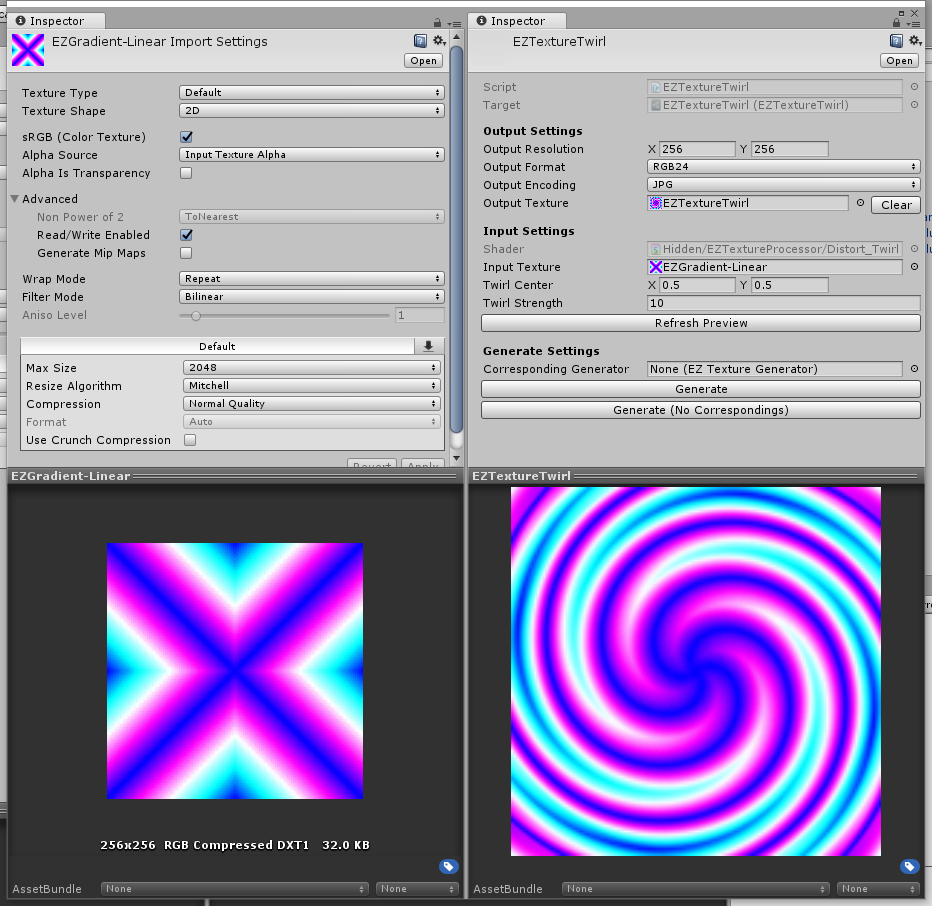

### EZTextureChannelModifier

Adjusts texture channels, including swapping channels, extracting a single channel, and applying curves to individual channels.

- Input Texture: Base texture; outputs white by default.
- Output Curve: Adjustment curve for the base texture.
- Overrides: Per-channel input and output settings.
  - Texture: Input texture for the channel.
  - Channel: Input channel from the input texture.
  - Curve: Output curve for the input channel.

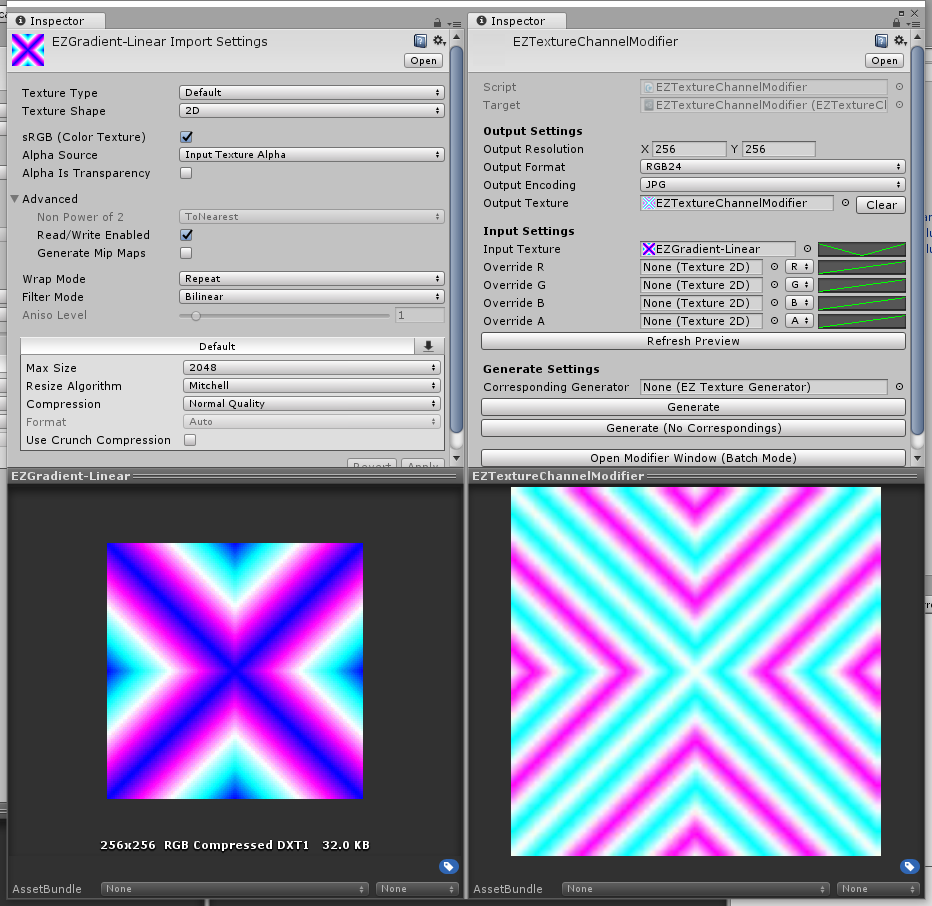

### EZTextureCombiner

Combines textures. All input textures must have the same dimensions.

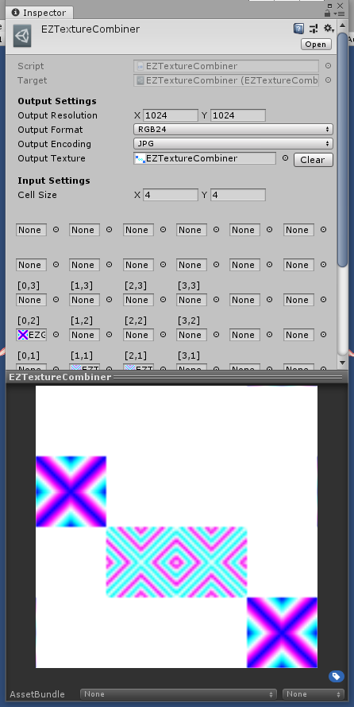

### EZMaterialToTexture

Renders a material directly to a texture. Do not use shaders that depend on lighting.

### EZTexturePipeline

Runs multiple texture processors in sequence. Unlike `Cooresponding Generator`, the pipeline does not generate intermediate textures.

## Usage

Create mesh generators, texture generators, and texture processors from:

`Assets/Create/EZAssetGenerator/...`

Example assets can be imported from **Window > Package Manager > EZAssetGenerator > Samples**.

## Directory structure

```text
EZAssetGenerator/
├── Runtime/              Runtime assets and texture-generation components
├── Editor/               Custom inspectors and editor previews
├── Shaders/              Shaders used by texture processors
├── Samples~/Demo/        Example mesh-generation and texture-processing assets
├── Documentation~/Images Documentation images
├── package.json          Unity Package Manager metadata
├── README.md             Chinese documentation
├── README_EN.md          English documentation
├── CHANGELOG.md          Release history
└── LICENSE               MIT license
```
